# 🚀 Awesome AI Tool Integration & Agent Tools Ecosystem

  

<!-- Badges Section -->

  
  
  
  
  
  
  

  <strong>Curated Directory of SaaS Platforms &amp; Open-Source Projects for AI Agent Tool Calling, MCP Gateways, and Action Connectors</strong>

  <em>Supercharge Autonomous AI Agents with Model Context Protocol (MCP) Servers, OAuth Toolkits, Function Calling, API Orchestrators, and Sandboxed Execution.</em>

  <strong>Last updated: November 2026</strong>

---

## 📖 Overview & Ecosystem Landscape

Autonomous AI agents and Large Language Models (LLMs) need reliable ways to interact with real-world software. This curated list tracks top **SaaS platforms** and **open-source repositories** designed for **AI Tool Integration & Agent Tools**. These solutions empower AI agents to seamlessly bridge with hundreds of external SaaS applications, REST/GraphQL APIs, relational databases, web browsers, and sandboxed developer environments—offering built-in OAuth management, standardized Model Context Protocol (MCP) schemas, isolated tool runtimes, and framework-agnostic function calling.

Whether building enterprise AI workflows with **LangGraph**, **CrewAI**, **Autogen**, or standalone **MCP clients** like Claude Desktop, Cursor, and Windsurf, this directory indexes essential infrastructure components for high-reliability agent tool execution.

---

## 📑 Table of Contents

- [📊 Sector Overview & Market Dynamics](#-sector-overview--market-dynamics)
- [☁️ SaaS & Hosted Platforms](#-saas--hosted-platforms)
- [💻 Open-Source GitHub Projects](#-open-source-github-projects)
- [🌟 Star History](#-star-history)
- [🤝 How to Contribute](#-how-to-contribute)
- [💖 Support & Sponsorship](#-support--sponsorship)
- [⚖️ Disclaimer & License](#-disclaimer--license)

---

## 📊 Sector Overview & Market Dynamics

The global market for **AI Agents and Agentic Infrastructure** is estimated at **$7.1B–$7.9B in 2025** and is projected to expand rapidly past **$10.9B in 2026** at a compound annual growth rate exceeding 40%. The tool-integration and action layer is currently **moderately-to-highly fragmented**—characterized by thousands of disparate enterprise APIs and fast-evolving standards like Anthropic's Model Context Protocol (MCP)—rather than a winner-take-all monopoly, leaving substantial room for specialized gateways, unified API bridges, open-source runtimes, and secure sandbox providers to co-exist.

---

## ☁️ SaaS & Hosted Platforms

Below is a breakdown of prominent commercial SaaS platforms for AI tool integration, ranked in descending order by enterprise scale, corporate valuation, and annual revenue.

| SaaS Product | Company Scale / Valuation / Revenue | Pricing (Starting Tier) | Free Tier / Trial Limit | Key Focus & Agent Features |
| :--- | :--- | :--- | :--- | :--- |
| **[Zapier MCP & AI Actions](https://zapier.com)** | **$5.0B Valuation** (~$310M+ ARR) | **$19.99/mo** (Professional, billed annually) | **100 tasks/mo**, unlimited 2-step Zaps forever | Cloud integration giant offering 7,000+ app connectors, 30,000+ actions, and single-endpoint hosted MCP for AI agents. |
| **[LangSmith Hub (LangChain)](https://langchain.com)** | **$1.25B Valuation** ($160M+ Raised) | **$39/seat/mo** (Plus tier) | **5,000 base traces/mo**, 1 seat, prompt hub & playground forever | Enterprise AI tracing, evaluation playground, agent tool-schema registry, and hosted agent deployment hub. |
| **[Pipedream Connect](https://pipedream.com)** | **Acquired by Workday** (~$80M Prior Val / $22M Raised) | **$99.00/mo** (Startup tier, billed annually) | **100 credits/mo**, development & prototyping access forever | Developer integration platform with 2,500+ pre-built integrations, managed end-user OAuth, and native MCP servers. |
| **[Composio Cloud](https://composio.dev)** | **$29M Raised** ($1M+ ARR, Series A by Lightspeed) | **$29.00/mo** (Pro tier) | **100,000 tool calls/mo**, up to 3 team seats forever | Managed agent tool execution platform with 250+ enterprise apps (GitHub, Slack, Salesforce), SOC2, and native MCP/CrewAI SDKs. |
| **[Trigger.dev Cloud](https://trigger.dev)** | **$19M–$20M Raised** (Series A by Standard Capital) | **$10.00/mo** (Hobby tier) | **$5.00/mo compute credits**, 20 concurrent runs, unlimited tasks forever | Cloud durable background-jobs and multi-step AI agent task runtime handling long-running integrations without timeouts. |
| **[Apideck](https://apideck.com)** | **$7.5M Raised** (Series A by Airbridge) | **€599.00/mo** (Launch tier) | **Free sandbox testing** + trial up to 2,500 API calls | Real-time Unified API bridging CRM, ERP, accounting, and HRIS systems behind standardized schemas for agent tools. |
| **[Superface](https://superface.ai)** | **$6.2M Raised** (Seed by Tera & 42CAP) | **Usage-based / Custom Enterprise** (Zero tool-call markup) | **Free Hub tier** with unlimited API docs inspection and free dev tool connections | Dynamic API integration layer translating natural-language user intent into executable REST actions and function schemas. |
| **[Toolhouse](https://toolhouse.ai)** | **Pre-Seed Funded** (Ganas Ventures, 500 Global) | **$5.00 per 1,000 requests** (Go tier pay-as-you-go) | **500 free requests/mo** for testing cloud agent components forever | Turnkey agent tools app-store offering hosted web scrapers, code execution, search, and memory across LLM providers. |
| **[OpenTools](https://fulinlabs.com)** | **Bootstrapped / Indie** (Fulin Labs) | **Pay-per-successful-execution** ($1.00 starter prepaid deposit) | **$1.00 free credit balance** on workspace creation forever | Unified agent tool broker providing a single API balance to inspect, meter, and run third-party tools & MCP servers. |
| **[Smithery](https://smithery.ai)** | **Acquired by Arcade.dev** (Series A by SYN) | **$0.00 / Free Public Directory** (Hosted paid proxy sunsetted post-acquisition) | **100% Free public registry access** forever (no paywalls, unlimited discovery) | Universal registry and discovery directory for community and enterprise Model Context Protocol (MCP) servers. |

---

## 💻 Open-Source GitHub Projects

The open-source community drives innovation across Model Context Protocol (MCP) servers, sandboxed code interpreters, unified OAuth brokers, and function-calling engines. All repositories below are ordered in descending order by GitHub Stars_Count.

| Project & Repo | GitHub_Stars (Social) | License | Category & Core Capabilities |
| :--- | :--- | :--- | :--- |
| **[n8n](https://github.com/n8n-io/n8n)** |  | `Sustainable Use` | Fair-code self-hostable workflow automation platform featuring 400+ app connectors, native LangChain agent nodes, and built-in MCP server/client triggers. |
| **[LangChain](https://github.com/langchain-ai/langchain)** |  | `MIT` | Industry-standard agent engineering framework providing hundreds of pre-built integrations, tools, and execution harnesses across Python and TypeScript. |
| **[Browser-Use](https://github.com/browser-use/browser-use)** |  | `MIT` | Leading open-source web browsing tool and automation library enabling AI agents to interact with any website, bypass anti-bot obstacles, and parse DOM elements. |
| **[Official MCP Servers](https://github.com/modelcontextprotocol/servers)** |  | `MIT` | Anthropic's foundational reference collection of MCP servers connecting agents directly to Git, GitHub, PostgreSQL, SQLite, Filesystem, Puppeteer, and Slack. |
| **[Context7](https://github.com/upstash/context7)** |  | `Apache-2.0` | Upstash's developer-focused MCP platform injecting live library documentation, API specs, and accurate context directly into coding agents. |
| **[LiteLLM](https://github.com/BerriAI/litellm)** |  | `MIT` | Ultra-fast AI gateway and proxy with standardized OpenAI tool-calling across 100+ LLMs, load balancing, budget guardrails, and centralized logging. |
| **[LlamaIndex](https://github.com/run-llama/llama_index)** |  | `MIT` | Comprehensive data framework and agent tool registry (`ToolSpec`) bridging Notion, Slack, Jira, Gmail, Salesforce, and enterprise databases into LLM agents. |
| **[Agno (fka Phidata)](https://github.com/agno-agi/agno)** |  | `MPL-2.0` | High-performance multi-agent framework bundled with 80+ pre-built toolkits (`DuckDuckGo`, `YFinance`, `SQL`, `Docker`, `MCP`) and strict structured outputs. |
| **[Playwright MCP](https://github.com/microsoft/playwright-mcp)** |  | `Apache-2.0` | Microsoft's official MCP server equipping AI agents with deterministic web navigation, form input, screenshot capturing, and accessible DOM scraping. |
| **[Serena](https://github.com/oraios/serena)** |  | `GPL-3.0` | Powerful coding MCP toolkit providing semantic code retrieval, AST symbol manipulation, and language server protocol (LSP) tools for software agents. |
| **[Composio Core](https://github.com/ComposioHQ/composio)** |  | `Apache-2.0` | Production agent tool engine powering 1,000+ app toolkits, local auth handling, sandboxed execution workbenches, and native MCP client/server bindings. |
| **[FastMCP](https://github.com/PrefectHQ/fastmcp)** |  | `Apache-2.0` | The fast, Pythonic standard framework for building, testing, proxying, and deploying Model Context Protocol (MCP) servers and clients with minimal boilerplate. |
| **[Stagehand](https://github.com/browserbase/stagehand)** |  | `Apache-2.0` | AI web browsing SDK by Browserbase built on Playwright for extracting structured data and interacting with web apps using natural language. |
| **[Activepieces](https://github.com/activepieces/activepieces)** |  | `MIT` | Open-source AI workflow automation platform featuring 280+ community pieces, approval gates, and automatic exposure of every flow as an MCP server. |
| **[Windmill](https://github.com/windmill-labs/windmill)** |  | `AGPL-3.0` | Ultra-fast developer platform converting Python, TypeScript, Go, and Bash scripts into instant APIs, UI dashboards, and MCP agent tool endpoints. |
| **[CAMEL](https://github.com/camel-ai/camel)** |  | `Apache-2.0` | Pioneer communicative multi-agent framework equipped with modular toolkits for browser automation, terminal execution, Google Scholar, and financial tools. |
| **[Trigger.dev Engine](https://github.com/triggerdotdev/trigger.dev)** |  | `Apache-2.0` | Open-source TypeScript background-job orchestrator and durable agent task runner supporting resilient tool calls, webhooks, and automatic retries. |
| **[Nango](https://github.com/NangoHQ/nango)** |  | `Elastic-2.0` | Unified developer infrastructure for managing OAuth 2.0 flows, token refreshes, and two-way sync integrations across 250+ SaaS APIs for AI tools. |
| **[Gorilla BFCL](https://github.com/ShishirPatil/gorilla)** |  | `Apache-2.0` | Groundbreaking research project behind the Berkeley Function Calling Leaderboard (BFCL) and specialized Gorilla open-weight tool-use models. |
| **[FastAPI-MCP](https://github.com/tadata-org/fastapi_mcp)** |  | `MIT` | Zero-configuration tool that inspects existing FastAPI and OpenAPI routes and automatically exposes them as native Model Context Protocol (MCP) servers. |
| **[mcp-use](https://github.com/mcp-use/mcp-use)** |  | `MIT` | Fullstack MCP client and server library enabling any LLM application to connect to and aggregate multiple remote/local MCP endpoints seamlessly. |
| **[ACI.dev](https://github.com/aipotheosis-labs/aci)** |  | `Apache-2.0` | AI-Computer Interface platform providing multi-tenant OAuth, fine-grained permission boundaries, and unified function calling across 600+ tools. |
| **[MetaMCP](https://github.com/metatool-ai/metamcp)** |  | `AGPL-3.0` | MCP aggregator, gateway proxy, and middleware unifying multiple STDIO/SSE MCP tool servers into a single namespace with dynamic tool filtering. |
| **[E2B Code Interpreter](https://github.com/e2b-dev/code-interpreter)** |  | `Apache-2.0` | Secure cloud and self-hosted sandboxed environment for executing AI-generated Python, JavaScript, and Bash scripts inside isolated MicroVMs. |
| **[Docker MCP Gateway](https://github.com/docker/mcp-gateway)** |  | `Apache-2.0` | Official Docker CLI plugin and gateway containerizing, isolating, and orchestrating multiple MCP servers behind a single protected local endpoint. |

---

## 🌟 Star History

---

## 🤝 How to Contribute

Contributions are warmly encouraged! To propose a new SaaS platform, open-source repository, MCP server, or tool integration:

1. **Fork** the repository to your GitHub account.
2. **Create a branch** for your updates (`git checkout -b feature/add-new-agent-tool`).
3. Ensure entries adhere to our objective criteria:
   - Must provide active tool-calling, MCP server capabilities, API integrations, or agent execution environments.
   - For SaaS entries: Include verifiable starting pricing, free tier/trial limits, and company scale metrics.
   - For Open-Source entries: Include GitHub social Stars_Badge (`style=social&color=white`) linking to its stargazers page.
4. **Commit** your changes with clear messaging (`git commit -m "Add NewTool to Open-Source list"`).
5. **Open a Pull Request** against `main` for review.

---

## 💖 Support & Sponsorship

If you find this ecosystem directory useful for your AI agent development, MCP integration research, or workflow architecture:

- ⭐ **Star** this repository to help others discover it!
- 🍴 **Fork** and contribute new tool integrations!
- 📢 **Share** with your network and team!
- ☕ **Buy a coffee & sponsor**: Consider supporting continued maintenance and updates via the **[GitHub Sponsor Dashboard](https://github.com/sponsors/ishandutta2007)**.

Thank you so much to all the sponsors, contributors, and the global AI engineering community! 🚀

---

## ⚖️ Disclaimer & License

*Disclaimer: All product names, logos, and brands are property of their respective owners. Mention of SaaS or open-source products does not constitute formal endorsement.*

Distributed under the **MIT License**. Check [LICENSE](file:///C:/Users/ishan/Documents/Projects/Awesome-AI-Tool-Integration-Agent-Tools/LICENSE) for more information.
